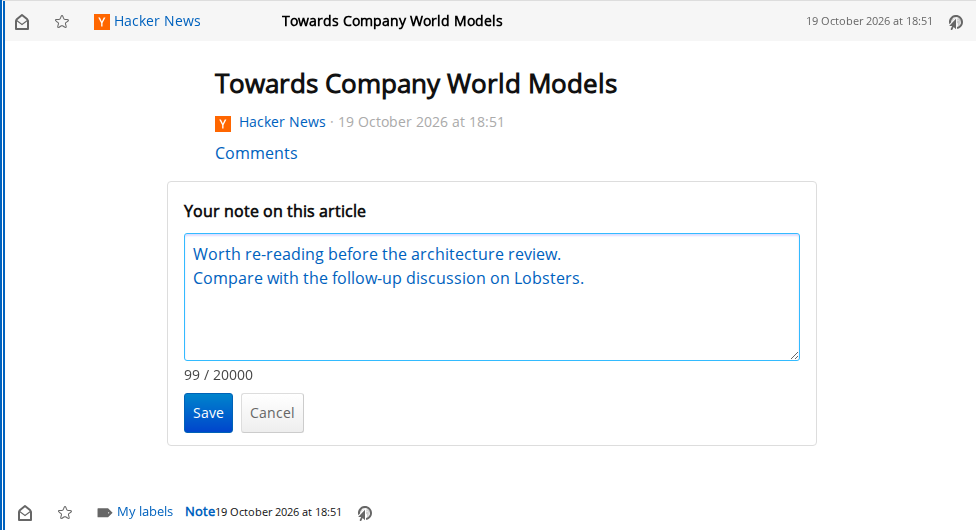
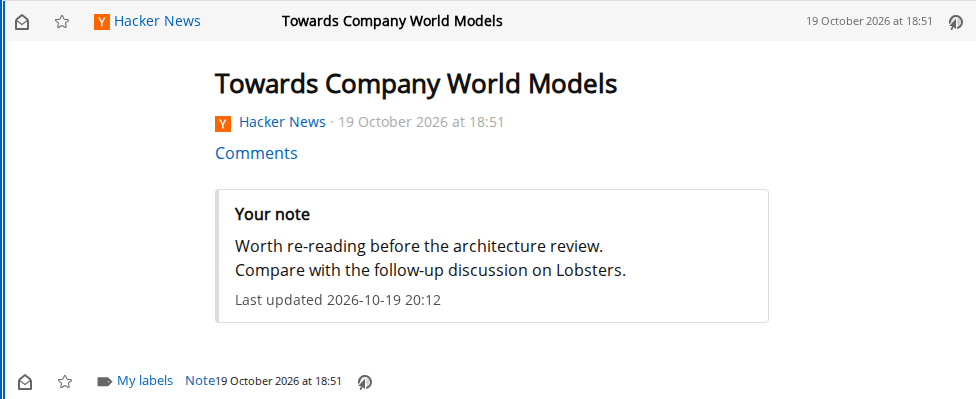
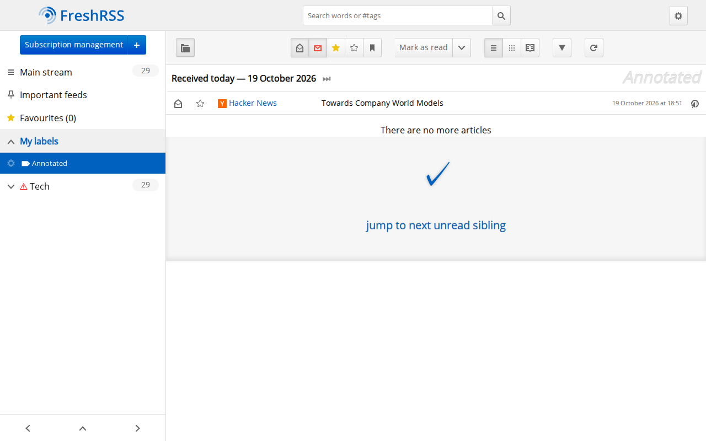
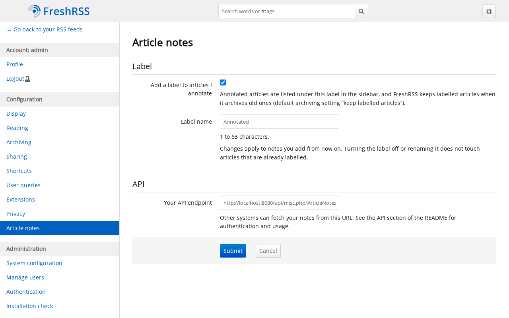

# FreshRSS Article Notes

[](https://github.com/NotDaveLane/freshrss-article-notes-extension/actions/workflows/ci.yml)

**ArticleNotes** is an open-source [FreshRSS](https://freshrss.org/) extension that lets you attach a personal note to any
article for future reference, and exposes those notes through an authenticated FreshRSS API endpoint so other systems can
fetch and analyze them later.



## Features

- **One note per article per user**, editable and deletable, from a **Note** action on every article — see
  [Using notes](#using-notes). Notes are plain Markdown-ish text of up to 20,000 characters, always displayed escaped.
- **Snapshots**: every note keeps a copy of its article's title, link, author, date and feed, so it stays meaningful after
  FreshRSS purges the article.
- **An "Annotated" label** on the articles you annotate (optional and renamable per user), so you can browse them in the
  sidebar and FreshRSS keeps them when it archives old articles — see [Configuration](#configuration).
- **A JSON [API](#api)** to fetch and sync your notes (deletions included), find the article behind any page URL, and
  create, update and delete notes from other tools such as a browser extension, with your FreshRSS API password.
- **Highlights**: select text in an article to highlight it in one of five colours, with an optional note; they come
  back when you return to the article — see [Using highlights](#using-highlights). Also available through the API: passages
  selected on an article or any web page — see [Highlights](#highlights).
- **A Notes page** listing everything you annotated — article notes, page notes and highlights — grouped by article or
  page, with search, filters, in-place editing and export to Markdown or W3C Web Annotation JSON — see
  [The Notes page](#the-notes-page).
- **Built for third-party clients**: [`v1/annotated`](#annotated-targets) lists everything you annotated in one call,
  [`v1/annotations`](#w3c-web-annotation-export) exports it as W3C Web Annotation JSON-LD, an [OpenAPI 3.1
  description](#openapi) documents the whole API, [CORS](#cors-web-page-clients) can be enabled for web-page clients, and a
  [reference client](#reference-client) plus a [guide to building a browser extension](#building-a-client) show how to
  look up, display, create and edit notes and highlights for the page being viewed.
- Per-user data, SQLite / MySQL / MariaDB / PostgreSQL, English interface; licensed AGPL-3.0-or-later like FreshRSS.

| The note under its article | Annotated articles in the sidebar | Per-user settings |
| --- | --- | --- |
|  |  |  |

## Requirements

- **FreshRSS 1.27.0 or newer** (tested with 1.27.1 and 1.30.1). On older versions the extension logs a warning and does
  not register its API endpoint.
- **PHP**: whatever your FreshRSS version requires (PHP 8.1 or newer for FreshRSS 1.27–1.30); no extra PHP extension.
- **Database**: any database FreshRSS supports (SQLite, MySQL/MariaDB, PostgreSQL); the extension adds one table per user.
- **For the API only**: API access allowed by the administrator (Configuration → Authentication → "Allow API access"),
  and an API password for each user who uses it.

## Installation

ArticleNotes is a single directory, `xExtension-ArticleNotes/`, that goes into FreshRSS's `extensions/` directory
(`/var/www/FreshRSS/extensions` in the official Docker image). Pick one way to get it there:

**a) Release zip.** Download `ArticleNotes-X.Y.Z.zip` from the Releases (or Tags) page of this repository and unpack it
into `extensions/`; the zip contains just `xExtension-ArticleNotes/`:

```sh
cd /path/to/FreshRSS/extensions
unzip ~/Downloads/ArticleNotes-1.1.2.zip      # creates xExtension-ArticleNotes/
```

**b) Git.** Clone the repository (optionally check out a release tag such as `v1.1.2`) and copy the extension directory
(the rest of the repository is development tooling):

```sh
git clone <repository URL> freshrss-article-notes
cp -r freshrss-article-notes/xExtension-ArticleNotes /path/to/FreshRSS/extensions/
```

**c) Docker** ([`freshrss/freshrss`](https://hub.docker.com/r/freshrss/freshrss)). Bind-mount the unpacked
`xExtension-ArticleNotes/` into the container's extensions directory, for example with Docker Compose:

```yaml
services:
  freshrss:
    image: freshrss/freshrss:1.30.1
    ports:
      - "8080:80"
    volumes:
      - freshrss_data:/var/www/FreshRSS/data
      - ./xExtension-ArticleNotes:/var/www/FreshRSS/extensions/xExtension-ArticleNotes:ro
volumes:
  freshrss_data:
```

(or `docker run … -v "$PWD/xExtension-ArticleNotes:/var/www/FreshRSS/extensions/xExtension-ArticleNotes:ro" freshrss/freshrss`).
If you already mount a whole directory on `/var/www/FreshRSS/extensions` (as FreshRSS's documentation suggests), unpack
the zip into that directory instead.

The files must be readable by the web server (`www-data` in the Docker image). Then:

1. **Enable it, as an administrator**: Configuration → Extensions → **ArticleNotes** → enable. It is a *system* extension:
   it is enabled once for the whole instance, and every user gets their own notes and settings.
2. **To use the API**, the administrator allows API access (Configuration → Authentication → "Allow API access"), and each
   user sets an API password: Configuration → Profile → "External access via API" → **API password**, then Submit.

## Using notes

Open an article and click **Note** in its action bar (next to the read, favourite and sharing icons; also in the reading
and global views). Type your note and press **Save**; **Cancel** (or Escape) closes the editor, and **Delete** removes an
existing note. Notes are plain text of up to 20,000 characters, shown under the article in a "Your note" block with the
time of the last update; HTML and Markdown are never rendered. Saving an empty note deletes it. To edit an existing note,
you can also click or tap the "Your note" block itself (or focus it with Tab and press Enter); selecting text in it to copy
it does not open the editor.

## Using highlights


Select text inside an article's content: a small toolbar appears next to the selection (below it on touch screens, so it
does not fight the browser's own selection menu). **Highlight** marks the passage in yellow with one click, the colour
buttons mark it yellow, green, blue, pink or purple, and **Add note** highlights it and opens a note field. Passages of up to
2,000 characters can be highlighted; selections in FreshRSS's own interface or in your article note get no toolbar.

- Highlights are drawn again whenever you open the article — in the normal, reading and global views, and for articles that
  arrive with infinite scroll. A highlight with a note is underlined with a dashed line, so it does not depend on colour.
- **Click or tap a highlight** (or focus it with Tab and press Enter) to open its popover: edit the note, change the
  colour, or **Delete** it. Escape closes the popover and returns focus to the highlight.
- Below the article, the **Annotations** panel lists your article note and all highlights in reading order, with the quote,
  colour and note of each and a **Jump to** button that scrolls to the highlight and focuses it. It is also the way to reach
  every highlight with a keyboard or a screen reader.
- If the article text changed so that a passage can no longer be found, the highlight is kept and listed in the panel as
  **Passage not found**: you can still read its quote and note, edit it or delete it.
- Highlights made on the original web page (for example by a browser extension using the [API](#highlights)) are drawn in
  FreshRSS too when their text is found in the article.
- The "Annotated" label is applied with the first note or highlight of an article, as for notes.

## The Notes page


Configuration → **Notes** (also linked from the settings page and from the **Annotations** panel under an article, as "All
my notes") lists everything you annotated, for any signed-in user. Annotations are grouped by article or web page, the most
recently annotated first, 25 groups per page. A group shows the title (a link to the article in FreshRSS, or to the page in a
new tab), the feed or site, the publication date, your note, and your highlights in document order with their colour, quote
and note. Articles that FreshRSS has purged are marked "Article no longer in FreshRSS"; highlights whose passage is no longer
in the article text are marked **Passage not found**. Each highlight of a FreshRSS article has an **Open article at this
highlight** link that opens the article and scrolls to it. Notes and quotes are always shown as text, never as HTML.

- **Search** looks in notes, highlight quotes and titles (case-insensitively; `%` and `_` are ordinary characters).
- **Filters** — kind (article notes, page notes, highlights), colour, feed and "only with a note" — combine with each other
  and with the search, and stay in the address when you turn pages.
- **Edit** opens a form under a note or highlight: change the text, change a highlight's colour, or delete it (after a confirmation). The field is labelled with what you are editing, and
  **Cancel** closes the form without saving. The same rules
  as elsewhere apply (20,000 characters; the "Annotated" label follows your notes and highlights).
- **Export** downloads what the current search and filters match, as **Markdown** (grouped like the page, quotes as
  blockquotes) or as **JSON in the [W3C Web Annotation](https://www.w3.org/TR/annotation-model/) format** (an
  `AnnotationCollection` with one `Annotation` per note or highlight: the URL as the target `source`,
  `TextQuoteSelector` / `TextPositionSelector` for highlights, `motivation` `commenting` / `highlighting`).

## Configuration

Every user has a settings page: Configuration → **Article notes** (no administrator needed).

- **Add a label to articles I annotate** (on by default): adding a note applies a FreshRSS label to the article, so annotated
  articles are listed under it in the sidebar. Deleting the note removes the label again, but only if the extension applied
  it (a label you had added yourself stays).
- **Label name** (default `Annotated`, 1–63 characters): the label is created the first time it is needed.

Turning the label off or renaming it affects notes you add from then on; already labelled articles keep their label.
Labelled articles are kept by FreshRSS's default archiving setting "keep labelled articles" (Configuration → Archiving),
so annotated articles are not purged. The page also shows your API endpoint, `<FreshRSS base URL>/api/misc.php/ArticleNotes/`,
with a **Copy** button, a link to the Profile page where you set the [API password](#authentication) clients sign in with,
and a link to the [OpenAPI document](#openapi). It warns you when you have no API password yet or when the administrator
has not allowed API access.

Administrators also have one setting, on the extension's own page (Configuration → Extensions → ArticleNotes → the gear
icon): **Allowed client origins**, for [web-page clients](#cors-web-page-clients). It is empty by default.

## API

ArticleNotes serves each user's notes as JSON on FreshRSS's extension API endpoint:

```
https://freshrss.example.net/api/misc.php/ArticleNotes/v1/...
```

(`/api/misc.php/v1/...?ext=ArticleNotes` works too.) Every path accepts `GET` and `HEAD`; the paths that write also accept
`PUT`, `POST`, `PATCH` or `DELETE`, as listed below. Any other method answers `405` with an `Allow` header. The whole
API is described by an [OpenAPI document](#openapi).

### Authentication

The API uses the same credentials as FreshRSS's Google Reader API, never your web login password:

1. An administrator allows API access (Configuration → Authentication → "Allow API access").
2. Each user sets an **API password** under Configuration → Profile, section "External access via API" → "API password".
   Use HTTPS: the password travels with every request.

Then authenticate every request with either:

- **HTTP Basic** with your user name and API password:

  ```sh
  curl -u alice:my-api-password https://freshrss.example.net/api/misc.php/ArticleNotes/v1/status
  ```

- **A Google Reader API token**, as returned by FreshRSS's ClientLogin:

  ```sh
  curl -d Email=alice -d Passwd=my-api-password https://freshrss.example.net/api/greader.php/accounts/ClientLogin
  # … Auth=alice/0123abcd…
  curl -H 'Authorization: GoogleLogin auth=alice/0123abcd…' \
    https://freshrss.example.net/api/misc.php/ArticleNotes/v1/status
  ```

Wrong or missing credentials, disabled users and users without an API password get `401` with
`WWW-Authenticate: Basic realm="ArticleNotes"`. A user only ever sees and writes their own notes. Credentials come from the
`Authorization` header only: a FreshRSS session cookie never authenticates an API request, so writes need no CSRF token.

### Endpoints

Every response, errors included, is JSON (`application/json; charset=UTF-8`, `Cache-Control: no-store`). Errors look
like `{"error": {"code": "not_found", "message": "…"}}` with the codes `invalid_parameter`, `invalid_json` and `invalid_body`
(400), `unauthorized` (401), `not_found` (404), `method_not_allowed` (405), `url_is_article` (409),
`precondition_failed` (412), `payload_too_large` (413), `unsupported_media_type` (415), `note_too_long` and
`title_too_long` (422) and `internal_error` (500). Highlights add `uuid_conflict` (409), `invalid_selector`,
`invalid_source`, `invalid_color`, `invalid_target`, `invalid_url`, `invalid_uuid`, `selector_immutable` and
`too_many_highlights` (400/422, see [Highlights](#highlights)).

- `GET v1/status` — a cheap credentials check:
  `{"extension": "ArticleNotes", "version": "1.1.2", "api_version": 1, "user": "alice", "note_count": 12}`
  (`note_count` counts live notes).
- `GET v1/notes` — your notes, oldest change first (ordered by `updated_at`, then `id`):
  `{"notes": [ … ], "continuation": "…" or null, "server_time": 1760900000}`. Parameters:
  - `limit`: notes per page, 1–500 (default 100);
  - `since`: Unix time; only notes created, edited or deleted at or after it;
  - `include_deleted`: `1` to include deleted notes (tombstones), `0` to leave them out; defaults to `1` when `since`
    is given, `0` otherwise;
  - `continuation`: the `continuation` of the previous page, to get the next one (it keeps the filters of the first
    request). It is `null` on the last page.
- `GET v1/notes/<entry_id>` — `{"note": { … }}`, the live note of one article, with an `ETag` header; `404` when there
  is none.
- `GET v1/lookup?url=<page url>` — which of your articles is this web page? See [Looking up a page](#looking-up-a-page).
- `PUT v1/notes/<entry_id>` — create (`201`) or update (`200`) the note of an article; see
  [Writing notes](#writing-notes).
- `DELETE v1/notes/<entry_id>` — delete the note (`204`; `404` when there is none).
- `GET`, `PUT` and `DELETE v1/page-notes?url=<page url>` — the note of a web page that is not an article; see
  [Page notes](#page-notes).
- `POST v1/highlights`, `GET`/`PATCH`/`DELETE v1/highlights/<uuid>` and `GET v1/highlights` — see [Highlights](#highlights).
- `GET v1/annotated` — every article and page you annotated, one entry each; see [Annotated targets](#annotated-targets).
- `GET v1/annotations?format=w3c` — notes and highlights as W3C Web Annotation JSON-LD; see
  [W3C Web Annotation export](#w3c-web-annotation-export).
- `GET v1/openapi.json` — the [OpenAPI description](#openapi) of all this; the only path that needs no credentials.

### The note object

```json
{
  "id": 7,
  "kind": "article",
  "entry_id": "1760891234567890",
  "greader_item_id": "tag:google.com,2005:reader/item/00064185708646d2",
  "note": "Worth re-reading.\nSee also the follow-up post.",
  "created_at": 1760891300, "created_at_iso": "2025-10-19T16:28:20+00:00",
  "updated_at": 1760895000, "updated_at_iso": "2025-10-19T17:30:00+00:00",
  "deleted_at": null, "deleted_at_iso": null,
  "label_applied": false,
  "url": "https://example.org/post/42",
  "normalized_url": "https://example.org/post/42",
  "title": "An interesting post",
  "article": {
    "guid": "https://example.org/post/42",
    "url": "https://example.org/post/42",
    "title": "An interesting post",
    "author": "Jane Doe",
    "published_at": 1760880000, "published_at_iso": "2025-10-19T13:20:00+00:00",
    "feed": {"id": 3, "name": "Example blog", "url": "https://example.org/feed.xml"},
    "exists": true
  }
}
```

- `kind` is `"article"` for the note of an article and `"page"` for a [page note](#page-notes); `entry_id`,
  `greader_item_id` and `article` are `null` on page notes, whose `url` and `title` describe the page.
- `entry_id` is FreshRSS's article id, as a string; `greader_item_id` is the same article in the Google Reader API's
  long form, so you can correlate notes with items fetched through `greader.php`.
- `url` is the article's original URL and `normalized_url` its [normalized form](#url-normalization) (`null` when the
  article has no web URL); they stay available after FreshRSS purges the article.
- `note` is the text exactly as entered (plain text: escape it when you display it), or `null` for a deleted note.
- Timestamps are Unix seconds, with an ISO 8601 (UTC) `*_iso` twin.
- `article` is a snapshot of the article taken when the note was last saved; it stays available after FreshRSS
  purges the article, and `exists` tells whether FreshRSS still has it.

### Keeping a copy in sync

1. First sync: page through `GET v1/notes` (following `continuation` until it is `null`) and remember the
   `server_time` of the **first** page.
2. Next syncs: `GET v1/notes?since=<that server_time>`, again following `continuation`, and remember the new first
   page's `server_time`. Changes since then include deleted notes: when `deleted_at` is set, delete your copy.
3. Apply notes by `entry_id` (or `id`): `since` is inclusive, so a note can come again; treat it as an update.

```sh
curl -u alice:my-api-password 'https://freshrss.example.net/api/misc.php/ArticleNotes/v1/notes?limit=500'
curl -u alice:my-api-password 'https://freshrss.example.net/api/misc.php/ArticleNotes/v1/notes?since=1760900000'
curl -u alice:my-api-password 'https://freshrss.example.net/api/misc.php/ArticleNotes/v1/notes/1760891234567890'
```

### Looking up a page

A client that knows the URL of the page you are viewing (a browser extension, say) asks whether it is one of your
articles, and gets your note on it:

```sh
curl -u alice:my-api-password -G https://freshrss.example.net/api/misc.php/ArticleNotes/v1/lookup \
  --data-urlencode 'url=http://www.example.org/post/42/?utm_source=newsletter#comments'
```

```json
{
  "url": "http://www.example.org/post/42/?utm_source=newsletter#comments",
  "normalized_url": "https://example.org/post/42",
  "index_complete": true,
  "page_note": null,
  "matches": [
    {
      "entry_id": "1760891234567890",
      "greader_item_id": "tag:google.com,2005:reader/item/00064185708646d2",
      "title": "An interesting post",
      "url": "https://example.org/post/42",
      "published_at": 1760880000,
      "feed": {"id": 3, "name": "Example blog", "url": "https://example.org/feed.xml"},
      "note": null
    }
  ]
}
```

- `matches` has at most 20 articles, most recently published first: those whose link (or GUID, when it is a URL)
  matches, plus those with a note at that URL (so notes on articles FreshRSS has purged are still found). `note` is the
  [note object](#the-note-object) or `null`. A `url` that is not an `http(s)` URL answers `400 invalid_parameter`.
- FreshRSS does not index article links, so ArticleNotes keeps its own URL index, filled while FreshRSS refreshes your
  feeds and, for articles it has not seen yet, on lookups (a bounded number each). `index_complete` is `false` while
  articles remain to be indexed: a lookup may then miss an article that a later one finds.
- `page_note` is your [page note](#page-notes) at that URL, or `null`. It is returned even when an article matches
  the URL too.
- New keys may appear in these objects in later versions; ignore what you do not know.

#### URL normalization

Pages match when their normalized URLs are equal. The scheme and host are lowercased (international host names become
punycode); `http` and `https` are equivalent, as is a leading `www.`; default ports (80, 443), credentials and the
`#fragment` are dropped; the tracking parameters `utm_*`, `fbclid`, `gclid`, `mc_cid`, `mc_eid` and `ref_src` are removed
and the other query parameters sorted; a trailing slash is dropped (except on the root path); percent-encoded unreserved
characters are decoded. The normalized form is always written `https://` without `www.`: it is for matching, and
`url` keeps the original for display. `ftp:`, `javascript:` and other non-web URLs do not normalize.

### Writing notes

```sh
# Create or replace the note (201 when created, 200 when updated); the response is {"note": { … }}.
curl -u alice:my-api-password -X PUT -H 'Content-Type: application/json' \
  -d '{"note": "Worth re-reading."}' \
  https://freshrss.example.net/api/misc.php/ArticleNotes/v1/notes/1760891234567890

# Delete it (204)
curl -u alice:my-api-password -X DELETE \
  https://freshrss.example.net/api/misc.php/ArticleNotes/v1/notes/1760891234567890
```

Writes follow the rules of the UI: the text is trimmed, at most 20,000 characters (`422 note_too_long`), and an
empty text deletes the note (`204`). Annotating an article applies the "Annotated" label, as in the UI. An unknown
article answers `404`.

- A `PUT` or `DELETE` without `If-Match` overwrites or deletes whatever note is there, and the check and the write are not
  one atomic step: clients that may race with other edits (the FreshRSS UI, another device) should send `If-Match`.
- The body must be `application/json` (`415` otherwise), at most 64 KB (`413`), valid JSON (`400 invalid_json`) and an
  object with a string `note` (`400 invalid_body`).
- **Optimistic concurrency.** Note responses carry an `ETag`. Send it back as `If-Match` with `PUT` or `DELETE` to change
  the note only if nobody else did: otherwise you get `412 precondition_failed`. Without `If-Match` the write always
  applies; `If-Match: *` means "any existing note".

```sh
curl -i -u alice:my-api-password …/v1/notes/1760891234567890       # … ETag: "7-1760895000"
curl -u alice:my-api-password -X PUT -H 'Content-Type: application/json' -H 'If-Match: "7-1760895000"' \
  -d '{"note": "Edited."}' …/v1/notes/1760891234567890
```

### Page notes

A web page that is **not** one of your articles can have one note too (a browser extension keeps them), through
`v1/page-notes?url=<page url>`; the `url` is [normalized](#url-normalization), so variants of it are the same page.

```sh
# Create (201) or update (200) the page note; "title" is optional (at most 500 characters).
curl -u alice:my-api-password -X PUT -H 'Content-Type: application/json' \
  -d '{"note": "Check the pricing section.", "title": "Example pricing"}' \
  'https://freshrss.example.net/api/misc.php/ArticleNotes/v1/page-notes?url=https%3A%2F%2Fexample.org%2Fpricing'

# Read it (404 when there is none) or delete it (204).
curl -u alice:my-api-password -G …/v1/page-notes --data-urlencode 'url=https://example.org/pricing'
curl -u alice:my-api-password -X DELETE -G …/v1/page-notes --data-urlencode 'url=https://example.org/pricing'
```

- Same rules as [writing notes](#writing-notes): `ETag` / `If-Match`, the JSON body (`note`, plus the optional `title`),
  text of at most 20,000 characters (`422 note_too_long`; a title over 500 characters is `422 title_too_long`), and an
  empty text deletes the note.
- An article has its own note: when the URL is one of your FreshRSS articles, the request is refused with
  `409 url_is_article`, and the message names the `entry_id` to use with `PUT v1/notes/<entry_id>`.
- Page notes never get the "Annotated" label. If an article with that URL shows up later, both notes stay; a
  [lookup](#looking-up-a-page) returns the article (with its note) in `matches` and the page note in `page_note`.
- `GET v1/notes` lists page notes with the article notes (`kind`: `"page"`, tombstones included).

### Highlights

A highlight is a passage of text the user selected on a FreshRSS article (`"source": "freshrss"`) or on any web page
(`"source": "page"`), with an optional note and colour. An article or page can have up to 1,000. The server stores the
`selector` and never anchors it: clients find the passage again from `quote` (and `position` when it is still valid).

```sh
# Create (201). "uuid" is optional: send a UUID v4 so a retry returns the same highlight (200) instead of a duplicate.
# Target it with "entry_id" (a FreshRSS article) or "url" (an article with that URL, else a page).
curl -u alice:my-api-password -X POST -H 'Content-Type: application/json' \
  -d '{"uuid": "3f1c9a52-8d3e-4c8e-9a53-5e8f0b6f7a10", "url": "https://example.org/pricing", "source": "page",
       "title": "Example pricing", "color": "green", "note": "Compare with the competitor.",
       "selector": {"quote": {"exact": "Starts at 9 euros", "prefix": "Plans: ", "suffix": " per month"},
                    "position": {"start": 120, "end": 137}}}' \
  https://freshrss.example.net/api/misc.php/ArticleNotes/v1/highlights

# Read one (ETag header), change its note and/or colour (the selector is immutable: delete and recreate to move it).
curl -u alice:my-api-password …/v1/highlights/3f1c9a52-8d3e-4c8e-9a53-5e8f0b6f7a10
curl -u alice:my-api-password -X PATCH -H 'Content-Type: application/json' -H 'If-Match: "12-1760900000"' \
  -d '{"note": "Updated.", "color": "blue"}' …/v1/highlights/3f1c9a52-8d3e-4c8e-9a53-5e8f0b6f7a10
curl -u alice:my-api-password -X DELETE …/v1/highlights/3f1c9a52-8d3e-4c8e-9a53-5e8f0b6f7a10

# The live highlights of an article or page, in document order (by position.start, else creation).
curl -u alice:my-api-password -G …/v1/highlights --data-urlencode 'url=https://example.org/pricing'
curl -u alice:my-api-password -G …/v1/highlights -d entry_id=1760891234567890

# Sync everything changed since a time, tombstones included, with the paging of v1/notes.
curl -u alice:my-api-password -G …/v1/highlights -d since=1760900000 -d limit=100
```

- A highlight is `{"id", "uuid", "kind": "highlight", "entry_id", "greader_item_id", "url", "normalized_url", "title",
  "source", "selector", "color", "note", "created_at", "created_at_iso", "updated_at", "updated_at_iso", "deleted_at",
  "deleted_at_iso", "label_applied", "article"}`; `entry_id`, `greader_item_id` and `article` are null for a page. Colours:
  `yellow` (default), `green`, `blue`, `pink`, `purple`. `exact` is 1–2,000 characters, `prefix` and `suffix` at most 64.
  Notes are at most 20,000 characters, stored as entered and always shown escaped.
- Reading one or listing answers `{"highlight": {…}}` / `{"highlights": […]}`; `since` / `limit` / `continuation` /
  `include_deleted` work as for `v1/notes` (`{"highlights", "continuation", "server_time"}`). Deleting keeps a tombstone.
- `POST` is idempotent by `uuid`: the same uuid on the same target returns the existing highlight with `200`; the same
  uuid on another target, or of a deleted highlight, is `409 uuid_conflict`. `PATCH` and `DELETE` honour `If-Match`
  (`412`). A target at its limit is `422 too_many_highlights`.
- A `url` that is one of your articles attaches the highlight to that article. [Lookups](#looking-up-a-page) list
  `highlights` on each match and `page_highlights` for highlights on the URL itself.
- The "Annotated" label is applied with an article's first note or highlight and removed (only if ArticleNotes put it
  there) when the article has neither any more.

### Annotated targets

`GET v1/annotated` answers "what did the user annotate?" in one call, whatever the "Annotated" label says: one entry per
article or page that has a live article note, page note or highlight.

```sh
curl -u alice:my-api-password -G https://freshrss.example.net/api/misc.php/ArticleNotes/v1/annotated \
  -d since=1760900000 -d kind=article -d limit=50
```

```json
{
  "targets": [
    {
      "kind": "article",
      "entry_id": "1760891234567890",
      "greader_item_id": "tag:google.com,2005:reader/item/00064185708646d2",
      "url": "https://example.org/post/42",
      "normalized_url": "https://example.org/post/42",
      "title": "An interesting post",
      "article": {"guid": "…", "url": "…", "title": "…", "author": "Jane Doe", "published_at": 1760880000,
                  "feed": {"id": 3, "name": "Example blog", "url": "https://example.org/feed.xml"}, "exists": true},
      "note": {"id": 7, "kind": "article", "note": "Worth re-reading.", "…": "…"},
      "highlight_count": 3,
      "highlight_colors": ["yellow", "pink"],
      "first_annotated_at": 1760891300, "first_annotated_at_iso": "2025-10-19T16:28:20+00:00",
      "last_annotated_at": 1760895000, "last_annotated_at_iso": "2025-10-19T17:30:00+00:00"
    }
  ],
  "removed": [{"kind": "page", "entry_id": null, "greader_item_id": null, "url": "https://example.org/old", "normalized_url": "https://example.org/old"}],
  "continuation": null,
  "server_time": 1760900100
}
```

- `kind` is `article` or `page`; `article` is `null` and `entry_id` / `greader_item_id` are `null` for a page. `note` is the
  [note object](#the-note-object) of the article note or page note, or `null`; `highlight_count` and `highlight_colors`
  (distinct, in the palette's order) count live highlights only.
- `last_annotated_at` is the latest `updated_at` among the target's live note and highlights, `first_annotated_at` the
  earliest `created_at`. Targets come most recently annotated first (then by article id, then by page, both descending).
- `limit` (1–500, default 100) and `continuation` page like `v1/notes`; `kind` (`article` or `page`) and `feed_id` (articles of
  one FreshRSS feed) filter, and the `continuation` keeps the filters.
- `since` (Unix time) returns the targets with an annotation created, edited or **deleted** at or after it, and a `removed`
  list (on the first page) of the targets that changed but have no live annotation any more, so a client can drop them. Store
  `server_time` for the next `since`. Without `since` there is no `removed`.
- It is one grouped query over notes and highlights plus a fixed number of lookups for the page of results, however many
  targets you have.

### W3C Web Annotation export

`GET v1/annotations?format=w3c` returns notes and highlights as [W3C Web Annotation](https://www.w3.org/TR/annotation-model/)
JSON-LD (`Content-Type: application/ld+json`), the same mapping as the Notes page export: an `AnnotationCollection` whose
`first` page holds one `Annotation` per note or highlight (`motivation` `commenting` / `highlighting`, a `TextualBody`, the
page URL as the target `source`, `TextQuoteSelector` and `TextPositionSelector`). The `id` of an annotation is
`urn:uuid:<uuid>` for a highlight and `urn:articlenotes:note:<id>` for a note.

```sh
curl -u alice:my-api-password -G …/v1/annotations -d format=w3c -d since=1760900000 -d limit=100
curl -u alice:my-api-password -G …/v1/annotations -d format=w3c --data-urlencode 'url=https://example.org/pricing'
```

- Without `entry_id` / `url` it lists what changed at or after `since` (default: everything), oldest change first, with
  `limit` (1–500, default 100) and `continuation` as for `v1/notes`; the extra members `continuation` and `server_time` sit
  next to `first` in the collection. Only live annotations are exported: the W3C model has no deletions, so use the native
  endpoints to sync them.
- `entry_id` (an article) or `url` (a page, or the article with that URL) exports everything on that one target.

### OpenAPI

[`docs/openapi.yaml`](docs/openapi.yaml) is an OpenAPI 3.1 description of the whole `v1` API: authentication, every endpoint,
the note, highlight and annotated-target schemas, errors, and the `ETag` / `If-Match` rules. Your instance serves it as JSON,
without authentication, at `<FreshRSS base URL>/api/misc.php/ArticleNotes/v1/openapi.json` (with your API URL as its
`servers` entry), so you can feed it to a code generator or an API explorer. CI validates it against the OpenAPI 3.1 schema
and fails when a route is not described (or a described route does not exist).

### CORS (web-page clients)

Browsers only let a web page call the API when the server says so. **Browser extensions with host permissions for your
FreshRSS address do not need CORS at all**; it is for pages and extension pages that call the API from another origin.

An administrator lists the allowed origins under Configuration → Extensions → ArticleNotes → **Allowed client origins**, one
per line: exact origins such as `https://notes.example.com`, `http://localhost:8000`, `moz-extension://<uuid>` or
`chrome-extension://<id>`. Wildcards (`*`), paths and other schemes are refused and nothing is saved. The list is empty by
default, and then no CORS header is ever sent.

For a request from a listed origin the API answers `OPTIONS` preflights with `204` (no credentials needed) and
`Access-Control-Allow-Methods`, `Access-Control-Allow-Headers: Authorization, Content-Type, If-Match` and
`Access-Control-Max-Age: 600`, and adds `Access-Control-Allow-Origin` (the request's origin), `Vary: Origin` and
`Access-Control-Expose-Headers: ETag` to every response. Other origins get no CORS header. `Access-Control-Allow-Credentials`
is never sent: credentials are in the `Authorization` header. Note that a page that is allowed to call the API still needs
the user's API password, which the page must obtain from the user and keep safe.

## Building a client

This is for someone writing a Firefox or Chromium extension that shows and edits notes and highlights for the page in the
current tab. The flow, with the [reference client](#reference-client) and the [anchoring library](#anchoring-library):

1. **On tab change** (`tabs.onUpdated` with `status: "complete"`, `tabs.onActivated`), debounce, then `GET v1/lookup?url=<tab URL>`.
   Skip URLs that are not `http(s)`. The server normalizes the URL (fragment, tracking parameters, `www.`, scheme), so send
   it as is.
2. **Show what is known.** If `matches` is not empty, the page is one of the user's FreshRSS articles: `matches[0].note`
   and `matches[0].highlights` are the article note and highlights (use `entry_id` for writes). Otherwise `page_note` and
   `page_highlights` are the page's. Always render notes and quotes as text (`textContent`), never as HTML.
3. **Anchor the highlights in the page.** In a content script, pick the page's main content (`document.querySelector('article')`,
   else `main`, else `document.body`) and call `anchor(highlight.selector, root)` from the anchoring library for the
   highlights with `source: "page"` (positions only mean something within one source; highlights made in FreshRSS's rendering
   have `source: "freshrss"` and are best-effort: try them too, and ignore the ones that do not anchor). Draw each with
   `highlight(range, {id, color})` right after anchoring it. A highlight that does not anchor is **orphaned**: keep it, list
   its quote with "passage not found", never delete it silently.
4. **Create highlights** from the user's selection: `describe(selection.getRangeAt(0), root)` gives the `selector`; send
   `POST v1/highlights` with a **client-generated `uuid`** (`crypto.randomUUID()`), `source: "page"`, the tab `url` and
   `title`. If the request fails or times out, retry with the same body: the same `uuid` returns the stored highlight
   (`200`) instead of creating a duplicate. Queue the request while offline.
5. **Save notes with `If-Match`.** Keep the `ETag` from every `GET`/`PUT`/`PATCH` of a note or highlight and send it back as
   `If-Match`. On **`412 precondition_failed`** someone else changed it (another device, FreshRSS itself): refetch, show
   the new text, let the user merge, and save again. For an article use `PUT v1/notes/<entry_id>`, for a page
   `PUT v1/page-notes?url=` (a URL that is an article answers `409 url_is_article`).
6. **Stay in sync** with `GET v1/notes?since=` and `GET v1/highlights?since=` (tombstones included), or list the user's
   annotated pages with [`v1/annotated`](#annotated-targets), for a "my notes" popup or to badge the toolbar icon.

### Authentication and storage

Use the user's FreshRSS **API password** (Configuration → Profile → "API password") with HTTP Basic, as in the
[Authentication](#authentication) section. Ask the user for the FreshRSS address, user name and API password once, check
them with `GET v1/status`, and store them in the extension's **local storage** (`browser.storage.local`; not `sync`,
which would copy the password to the browser vendor's servers). Require HTTPS for the FreshRSS address; plain `http` is only
acceptable for `localhost`. Be aware of the password's reach: the API password also grants access to FreshRSS's Google Reader
and Fever APIs for the whole account, not just to ArticleNotes, so tell the user, and never log or sync it. A Google Reader
token (`GoogleLogin auth=…`) works too, but expires when the API password changes.

### Firefox and Chromium specifics

- **Host permissions.** Declare the FreshRSS origin in `host_permissions` (Manifest V3; `permissions` in Manifest V2), e.g.
  `"host_permissions": ["https://freshrss.example.net/*"]`, and make the API calls from the background script (or
  event page). Extensions with host permissions bypass CORS: **no administrator setup is needed**. Firefox MV3 treats
  host permissions as optional for the user: request them with `permissions.request()` if they are not granted.
- **When CORS is needed.** Calling the API from a content script (it runs with the *page's* origin, so CORS applies to
  the page, not to your extension), from a web page, or from an extension page without host permission. Prefer message
  passing: the content script asks the background script to call the API. Otherwise the administrator adds the page's
  origin, or `moz-extension://<your extension's internal UUID>` / `chrome-extension://<id>`, under "Allowed client origins".
  The Firefox internal UUID differs per browser profile, which is why host permissions are the better route there.
- **Debounce lookups** on tab updates (a few hundred milliseconds): single-page apps fire many `onUpdated` events, and each
  lookup is a request. Remember the result per normalized URL for the life of the tab, and refresh it when the user edits.
- **Anchor against the page's main content**, not `document.body`, where you can: use `article`, then `main`, then `body`.
  Menus, cookie banners and comment widgets change between visits and shift positions; the anchoring library prefers the
  quote and its context over the position for that reason. Give your own injected UI the attribute `data-articlenotes-ui`
  so it is left out of the text model.
- **Performance**: anchor after the page settled (`document_idle`, or a `MutationObserver` for pages that render late) and
  anchor highlights one by one: drawing moves text nodes.

### Reference client

[`examples/notes-client.mjs`](examples/notes-client.mjs) is a small, dependency-free ES module for browsers and Node 18+
that wraps the API: `status()`, `lookup(url)`, article notes (`getNote`, `saveNote(entryId, text, etag)`, `deleteNote`), page
notes (`getPageNote`, `savePageNote`, `deletePageNote`), highlights (`listHighlights`, `getHighlight`, `createHighlight`
with a generated uuid, `updateHighlight`, `deleteHighlight`), and the syncs `listChangedSince('notes' | 'highlights', since)`
and `listAnnotated({since, kind, feedId})`, which follow `continuation` for you. Failures throw `ApiError` (`status`,
`code`); a `412` throws `PreconditionFailedError`.

```js
import { NotesClient, PreconditionFailedError } from './notes-client.mjs';

const client = new NotesClient({ baseUrl: 'https://freshrss.example.net', user: 'alice', apiPassword });
const found = await client.lookup(location.href);
const entryId = found.matches[0]?.entry_id;
let current = await client.getNote(entryId);
try {
	current = await client.saveNote(entryId, 'My note', current?.etag);
} catch (error) {
	if (!(error instanceof PreconditionFailedError)) throw error;
	current = await client.getNote(entryId);	// changed elsewhere: refetch, merge, save again
}
```

[`examples/highlight-page.html`](examples/highlight-page.html) is a static page that does what a content script does: it
connects with the form, looks itself up, anchors the stored highlights in its own text with the anchoring library, lets you
select text and store it as a highlight, and redraws everything after a reload; highlights whose passage is gone are listed
as "not found". Serve the three files (the page, `notes-client.mjs`, and `anchoring.js` from
`xExtension-ArticleNotes/static/`) from one directory over http(s), for example `python3 -m http.server 8000`, add that origin
(`http://localhost:8000`) to "Allowed client origins", and open it. Both are tested against the dev instance in CI.

## Anchoring library

`xExtension-ArticleNotes/static/anchoring.js` is the small JavaScript library that ArticleNotes uses to turn a text
selection into a highlight **selector** and to find that selector again in a page. It is a single, dependency-free ES
module (no build step), meant to be reused by other clients, such as a browser extension that highlights the original
web page: copy the file into your project (it is AGPL-3.0-or-later), or load it from your FreshRSS instance at
`https://freshrss.example.net/ext.php?f=xExtension-ArticleNotes/static/anchoring.js` (no sign-in needed). Use the same
library on both sides so that positions mean the same thing.

```js
import { describe, anchor, highlight, textOf, AnchoringError } from './anchoring.js';

const root = document.querySelector('article');          // the container of the article text
const selector = describe(window.getSelection().getRangeAt(0), root);
// {quote: {exact: 'brown fox', prefix: 'The quick ', suffix: ' jumps over'}, position: {start: 10, end: 19}}

const range = anchor(selector, root);                     // a DOM Range, or null: "passage not found"
if (range !== null) {
	const drawn = highlight(range, { id: 42, color: 'yellow' });  // <mark class="articlenotes-hl" data-id="42" data-color="yellow">
	drawn.remove();                                        // restores the original DOM
}
```

- `describe(range, root)` returns the selector of a DOM `Range` inside `root`. `exact` is the selected text with
  whitespace collapsed; `prefix` and `suffix` are up to 64 characters of the text around it; `position` holds offsets
  into `textOf(root)`. It throws an `AnchoringError` whose `code` is `empty`, `too-long` (more than 2,000 characters) or
  `outside-root`.
- `anchor(selector, root)` finds a selector: at `position` if the text there still is `exact`, otherwise at the
  occurrence of `exact` whose surroundings best match `prefix` and `suffix` (the position only breaks ties), otherwise
  the same search ignoring whitespace. It returns `null` when the passage is gone: keep such a highlight and show it as
  "passage not found". Malformed selectors throw an `AnchoringError` with code `invalid-selector`.
- `highlight(range, attrs)` wraps the text of the range in `<mark class="articlenotes-hl">` elements, with `attrs` as
  `data-*` attributes, using DOM operations only (stored text is never parsed as HTML). Highlights may overlap. It
  returns `{marks, remove()}`. Anchor each highlight right before drawing it: drawing moves text nodes, which collapses
  other ranges you already hold.
- `textOf(root)` is the text the positions count in (UTF-16 code units, like DOM offsets): the text nodes of `root`
  without `<script>`, `<style>`, hidden elements and ArticleNotes' own UI (elements with `data-articlenotes-ui`), with a
  line break at block boundaries and `<br>`. It follows every change inside `root`, but not styles changed from outside
  it (a class on an ancestor, a new stylesheet) that hide or show parts of it.
- Lengths are counted in characters (Unicode code points): `exact` is 1–2,000 characters, `prefix` and `suffix` at most
  64.

The selector mirrors the [W3C Web Annotation](https://www.w3.org/TR/annotation-model/#selectors) `TextQuoteSelector`
(`quote`) and `TextPositionSelector` (`position`).

## Upgrading

**To 1.1.2** (from 1.1.0 or 1.1.1): replace the directory, nothing else changes (no migration). It fixes the Notes
page on MySQL and MariaDB and brings small note editor, settings and Notes page improvements.

**To 1.1.1** (from 1.1.0): a bug-fix release; replace the directory, nothing else changes (no migration).

**To 1.1.0** (from 1.0.0): nothing else is needed. The first time each user's storage is used (or at the next feed refresh) the
extension adds its tables for page notes and highlights (migrations `0004`–`0007`); notes stay as they are, and the API
answers as before with new endpoints added (`v1/annotated`, `v1/annotations`, `v1/openapi.json`, highlights and page notes) and
new keys in note objects. CORS stays off until an administrator lists origins.

Replace the `xExtension-ArticleNotes/` directory with the new release (unpack the new zip over it, `git pull` and copy
again, or update your bind mount's source). Nothing else is needed: the extension keeps a schema version per user and
applies any missing database migrations automatically, the first time it uses its storage for that user and during
FreshRSS's regular feed refresh (cron). Your notes and settings are kept. Versions and changes are listed in
[CHANGELOG.md](CHANGELOG.md).

## Uninstalling

- **Disabling** the extension (Configuration → Extensions, administrator) keeps every user's notes and settings; enabling it
  again brings everything back. FreshRSS's **Remove** button deletes the `xExtension-ArticleNotes/` directory and also
  keeps the data (as does deleting the directory yourself).
- **To delete the data permanently**, run the extension's script from the FreshRSS directory *before* removing the
  extension, as the web server user:

  ```sh
  cd /var/www/FreshRSS
  sudo -u www-data php extensions/xExtension-ArticleNotes/cli/delete-data.php --yes                # every user
  sudo -u www-data php extensions/xExtension-ArticleNotes/cli/delete-data.php --yes --user alice   # one user
  # Docker: docker exec -u www-data freshrss php extensions/xExtension-ArticleNotes/cli/delete-data.php --yes
  ```

  It drops the notes table (`articlenotes_note` with FreshRSS's per-user prefix: every note and tombstone) and removes the
  extension's settings of those users. The labels it created (e.g. "Annotated") are ordinary FreshRSS labels and stay,
  with their articles; delete them in Subscription management → Label management if you no longer want them.

## FAQ and troubleshooting

- **There is no "Note" button.** The extension is not enabled (Configuration → Extensions, as an administrator), or the
  page was opened before it was enabled: reload it.
- **The API answers `404` with the plain text `Not Found!`** (FreshRSS 1.28 and newer). ArticleNotes is not enabled in
  the *system* configuration (an administrator must enable it), or the extension name in the URL is not spelled exactly
  `ArticleNotes`. If your web server does not pass the path after `misc.php` (`PATH_INFO`), use
  `…/api/misc.php/v1/status?ext=ArticleNotes`.
- **The API answers `503` (`Service Unavailable!`).** API access is disabled (Configuration → Authentication → "Allow API
  access"). FreshRSS 1.27 also answers `503` when ArticleNotes is not enabled system-wide or the name is misspelled.
- **`api/misc.php` does not exist** (a web server 404 page): FreshRSS is older than 1.27.0; upgrade FreshRSS.
- **The API answers `401` (JSON `unauthorized`).** The user name or API password is wrong; you used your web login password
  instead of the API password; the user has no API password yet (Profile → "External access via API"); the user is
  disabled; or a reverse proxy / PHP-FPM setup drops the `Authorization` header (forward it, e.g. Apache's
  `CGIPassAuth On`; FreshRSS's own Google Reader API needs it too).
- **`404` with the JSON `not_found` error** is the extension speaking: an unknown path, or no live note for that
  `entry_id`.
- **Where are errors logged?** In FreshRSS's logs (Configuration → Logs), in messages starting with `ArticleNotes`.

## Development

Everything runs in containers; you only need Docker with Compose. No PHP, Composer or Node on the host.

```sh
docker compose up --build -d --wait   # builds, installs, seeds, and waits until ready
```

- URL: find the port with `docker compose port freshrss 80` (default <http://localhost:8080/>;
  override with `FRESHRSS_PORT`). Another FreshRSS version: `docker compose down -v`, then
  `FRESHRSS_VERSION=1.27.1 docker compose up --build -d --wait`.
- Login: `admin` / `freshrss-dev-password` (API password `freshrss-dev-api`). These are
  development-only defaults; override them by copying `.env.example` to `.env`.
- The instance is subscribed to Hacker News and Lobsters (empty if you are offline) and the
  extension is mounted from `xExtension-ArticleNotes/` and enabled.
- A fixture feed is served inside the compose network at `http://fixtures/feed.xml`.

```sh
docker compose down        # stop, keep data
docker compose down -v     # stop and reset everything (fresh install on next start)
```

### Tests and quality checks

With the stack up, one command runs everything in containers (code style, static analysis, ESLint, PHPUnit with
coverage, Playwright end-to-end tests, including the anchoring library's tests in a real browser):

```sh
bin/ci               # SQLite only; HTML coverage in coverage/index.html (PHP) and coverage/js/index.html (anchoring.js)
bin/ci --all-dbs     # also run the integration tests on MariaDB and PostgreSQL
bin/ci --compat      # the matrix: bin/ci --all-dbs on FreshRSS 1.27.1 and 1.30.1, each in a throwaway stack
```

`bin/ci --compat` does not need (or touch) the dev stack; set `COMPAT_VERSIONS` (e.g. `COMPAT_VERSIONS="1.27.1"`) to pick
versions. It lints on the default version only, as FreshRSS's APIs and coding standard differ between versions.

GitHub Actions ([`.github/workflows/ci.yml`](.github/workflows/ci.yml)) runs the same matrix on every push to `main` and
every pull request, one job per FreshRSS version; each job uploads its coverage reports and Playwright results.

`bin/openapi` regenerates the copy of `docs/openapi.yaml` that the API serves (`xExtension-ArticleNotes/openapi.json`; a test
fails when it is stale). Single runs: `bin/phpunit tests/Unit/MetadataTest.php`, `TEST_DB=postgres bin/phpunit --testsuite integration`,
`FRESHRSS_VERSION=1.27.1 bin/phpunit`, `bin/e2e specs/full-journey.spec.ts`, `bin/lint`. End-to-end tests use throwaway
users subscribed to the local fixture feed, never the live feeds.

The suite fails on PHP warnings, notices and deprecations: in any response an end-to-end test receives, in PHPUnit, and in
FreshRSS's log after the end-to-end run when they come from the extension's files or pages (`bin/check-php-log`).

`bin/screenshots` refreshes the pictures in `docs/screenshots/` from the dev instance (seeded Hacker News content).

### Releasing

Maintainers:

1. Bump `version` in `xExtension-ArticleNotes/metadata.json` and move the `[Unreleased]` entries of `CHANGELOG.md` under a
   new `## [X.Y.Z] - YYYY-MM-DD` heading (a test fails if the two disagree).
2. Run `bin/ci --compat`, commit, and tag `vX.Y.Z`.
3. Run `bin/openapi` if `docs/openapi.yaml` changed (its `info.version` must equal the release version), then
   `bin/package` builds `dist/ArticleNotes-X.Y.Z.zip` (only `xExtension-ArticleNotes/`); `bin/verify-release` installs
   that zip into a clean `freshrss/freshrss` container, enables it as the administrator, adds a note and fetches it
   through the API.
4. Push the commit to `main` and, once its CI run passes, push the tag (`git push origin vX.Y.Z`). The Release workflow
   (`.github/workflows/release.yml`) repeats `bin/package` and `bin/verify-release` and publishes a GitHub release with
   the zip attached and the version's `CHANGELOG.md` section as its notes.

See [AGENTS.md](AGENTS.md) for conventions, specs and the full command list.

## License

AGPL-3.0-or-later, like FreshRSS. See [LICENSE](LICENSE).
